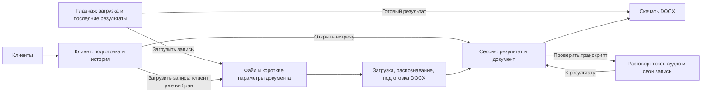

# Кабинет коуча: сценарии и устройство работы

4 ноября 2026 года. Целевой UX принят к работе ответом Сергея «Делаем». Первый проход реализован локально; документ в целом остаётся целевым поведением, а не утверждением, что все 14 сценариев завершены. Основание: [интервью](../research/2026-11-04-wife-interview.md), [объём первой версии](../features/coach-cabinet-v1.md), D03–D05 и текущие компоненты `.local/web/app/cabinet/ui/`.

Обратная связь Сергея: «UI более-менее, но вот UX очень слабый. Много лишних действий, табов». В этой итерации сохраняем визуальное направление и пересматриваем пути выполнения задач. В первом проходе изменён код основного пути и убраны внутренние вкладки сессии. Проверки и ограничения реализации — в `.local/web/docs/coach-cabinet.md`.

Следующий локальный проход подключил автосохранение и черновики, конфликты вкладок, точные границы цитат, клиента на месте, постепенное заполнение выжимки, отмену статуса и переходы к эпизодам из подготовки, продолжение чтения/аудио и восстановление очищенного задания. Действия на телефоне имеют высоту 44 px; колонка записей — 344 px, а при нехватке ширины открывается отдельно. Проверка кода: 63 теста с реальным JSON, ESLint и сборка. Это не приёмка всей версии: живой конвейер, эталонный DOCX, физический телефон, самостоятельный пилот и размещение ещё не подтверждены.

## 1. Что известно и что пока предполагаем

Подтверждено: нужен веб с удобным доступом с телефона; транскрипт и DOCX; возможность вернуться к эпизоду; ручные заметки и рефлексия. Сохраняется история клиента. Транскрипт не должен быть первым содержимым при обычном открытии сессии. Главная не должна становиться дашбордом.

Сергей уточнил основной приоритет в этом разговоре: «основа — это то, с чего начинался сервис. загрузить запись, сделать транскрипт, получить в нужном формате docx. потом всё остальное вокруг этого» ([D05](../../DECISIONS.md)). Поэтому первыми проектируем S1–S2: путь от файла до пригодного документа. Чтение и правка помогают получить этот результат; заметки, клиентская история и подготовка идут следующим слоем.

Частота отдельных дополнительных сценариев не измерена. В интервью нет наблюдения за обычным рабочим днём. Приоритет основного результата подтверждён владельцем; удобство предложенных действий ещё нужно проверить с женой.

## 2. Главная проблема нынешнего UX

Интерфейс разложен по объектам хранения и режимам редактирования. Одна задача требует переходить между ними. Это разбор исходников, без замера времени и числа кликов на пользователе.

| Задача | Как устроено сейчас | Где возникает лишняя работа |
|---|---|---|
| Добавить запись | Выбрать готовый JSON, последний результат или заметку; для аудио уйти в отдельный транскрибатор | Пользователь разбирается в технических способах импорта; единый путь ещё не подключён |
| Оставить мысли после встречи | Открыть сессию → «Записать свои мысли» → заполнить поля → «Сохранить» | Перед вводом нужно включить редактирование; сразу появляются все поля |
| Исправить оговорку ASR | Открыть транскрипт → «Править текст» → найти поле → сохранить; отдельно закончить правку | Глобальный режим нужен ради одной строки; сохранение и выход из режима — разные действия |
| Сохранить важный фрагмент | Включить выбор → указать границы → «В закладки» → диалог → сохранить | Много управления вокруг самого эпизода; чтение меняет вид на короткие исходные фрагменты |
| Послушать и записать наблюдение | Аудио во вкладке транскрипта, заметки — в обзоре | При смене вкладки плеер размонтируется; теряется состояние прослушивания |
| Вспомнить закладку | Открыть вкладку закладок → перейти обратно в транскрипт | Связанные части разговора взаимно скрыты |
| Скачать документ после правки | DOCX скрыт, пока есть любые несохранённые изменения | Даже личная заметка, которая не входит в документ, мешает скачиванию |
| Продолжить вчерашнюю работу | На главной последняя добавленная сессия | Дата добавления не означает, что с ней работали последней |
| Вернуться назад или обновить страницу | Переходы хранятся в состоянии одного React-компонента | Нельзя дать прямую ссылку на сессию; перезагрузка теряет открытый контекст, «Назад» браузера не повторяет путь |

Самый большой разрыв — для исходной задачи «аудио → нужный DOCX» кабинет пока требует отдельного транскрибатора и ручного переноса. Исправлять сначала только вкладки заметок означало бы улучшать обходной путь. Недостаточно просто убрать названия вкладок или спрятать их в меню.

## 3. Какие рабочие места нужны

**Главная — загрузить запись и забрать результат.** Основное действие «Загрузить запись» сразу открывает выбор файла; на компьютере можно перетащить его в ту же область. Не требуется сначала создавать сессию как отдельную сущность. Ниже короткий список последних загрузок с фактическим состоянием и прямым «Скачать DOCX» у готовых. Клиентский реестр, статистика и отдельная кнопка создания клиента сюда не возвращаются. Активная обработка или ошибка видна в соответствующей строке.

**Клиент — подготовиться и открыть историю.** На первом месте «Перед следующей встречей»: нужная часть последней выжимки и открытые договорённости. Затем история по дате встречи. Добавление сессии уже знает клиента. Контакты, архив и удаление не занимают основной экран.

**Сессия — результат обработки и документ.** По умолчанию готовый документ, его имена/дата/роли и основное действие «Скачать DOCX». Во время обработки здесь её состояние. Рядом «Проверить транскрипт», ниже необязательные свои записи и привязка к клиенту. Пустая форма рефлексии не становится главным содержимым готового результата. Сам транскрипт при обычном открытии не развёрнут.

**Работа с разговором — слушать, читать, править и отмечать рядом.** Текст занимает основную площадь, аудио остаётся доступным при прокрутке. Свои записи и закладки находятся рядом с источником. Это рабочий режим внутри той же сессии с сохраняемым адресом, а не ещё один раздел кабинета.

Верхняя навигация пока остаётся «Моя практика / Клиенты / Сессии». Проблема находится прежде всего внутри сессии; сокращать меню до двух пунктов без проверки поиска преждевременно. История всех сессий нужна и для материалов без клиента.



## 4. Основные пользовательские сценарии

Пути ниже начинаются после входа. Нажатия в системном выборе файлов, ввод текста и длительность обработки не считаем искусственно «одним кликом». Целевое число переходов проверим на прототипе.

### S1. После встречи добавить запись и уйти по своим делам

**Повод:** закончился разговор, есть файл. **Результат:** сессия сохранена, обработка идёт без открытой страницы, результат потом легко найти.

1. На главной «Загрузить запись» сразу открывает системный выбор файла. Из карточки клиента — тот же путь с уже выбранным клиентом. Не нужно сначала открыть диалог создания сессии.
2. После выбора файла на той же странице видны короткие параметры: язык записи, имя коуча и клиента в документе, дата. Имя коуча и предпочтительный язык уже подставлены, но доступны для правки. Имя предыдущего клиента, старую дату и номера говорящих из прошлой записи молча не переносим. Не требуем придумать тему и выбрать формат из набора шаблонов: используется текущий нужный формат DOCX.
3. «Сделать транскрипт» запускает загрузку и обработку. До этого не запускается платная обработка. Сессия создаётся и связывается с заданием автоматически. Во время отправки файла написано, что страницу пока закрывать нельзя; после подтверждённой загрузки — что обработка продолжится без неё.
4. После возвращения видна эта же запись и её состояние. Основной следующий шаг у готового результата — «Скачать DOCX». Готовность не означает, что текст проверен коучем.

Привязка к клиенту необязательна и находится в дополнительной строке. Имя клиента для DOCX не требует создания карточки. Из этого же поля можно по желанию выбрать существующую карточку или создать её по имени. Нельзя заводить клиента автоматически только потому, что имя введено для документа. Сессия без клиента полностью работоспособна.

Готовый JSON остаётся дополнительным способом ввоза старых материалов. Перенос из старого транскрибатора — временный переходный путь. Выбор между внутренними форматами не становится первой задачей коуча.

**Граница:** прямой путь аудио → обработка → сессия сейчас отсутствует. Его нельзя изображать работающим сменой надписи на кнопке. Пока интеграция не сделана, явно показываем «Импортировать готовый транскрипт», а отдельную обработку не маскируем.

**Проверка:** новый пользователь добавляет файл без объяснений про JSON; новая карточка клиента не обязательна; обновление страницы не создаёт вторую обработку.

### S2. Быстро получить документ

**Повод:** нужен транскрипт для дальнейшей работы или ментора; личные записи сейчас не нужны. **Результат:** DOCX с нужными именами, датой и назначенными ролями.

1. У готовой записи на главной или в истории нажать «Скачать DOCX». Открывать сессию ради одного скачивания не требуется. Если результат уже открыт после обработки, та же кнопка находится на первом плане.
2. Если роли не назначены, до экспорта показать короткую проверку прямо в результате: два участника, фрагмент речи каждого, выбор роли. Полный транскрипт ради этого открывать не нужно. Автоматически предложенная роль не выдаётся за подтверждённую. Скачивание с нейтральными подписями возможно отдельным явным выбором, не как молчаливый обычный результат.
3. Получить файл. Выжимка, закладки и клиентская карточка не нужны для скачивания. Для дополнительной проверки рядом «Проверить транскрипт».

Последние изменения текста, ролей и метаданных сначала сохраняются, затем создаётся документ. Это делает сама команда скачивания. Ошибка сохранения ясно останавливает создание нового документа; сохранённую старую версию можно скачать отдельным явным действием. Ошибка сохранения личной заметки не блокирует готовый транскрипт.

**Проверка:** получить документ можно без обязательного просмотра всего разговора и заполнения выжимки; скачанный документ соответствует указанной версии текста.

### Что значит «документ в нужном формате»

Это отдельный критерий результата, а не наличие расширения `.docx`. Берём используемый сейчас образец документа, не меняем его оформление вслед за дизайном кабинета. Для проверки фиксируем выбранные примеры RU/EN и сравниваем шапку с именами/датой, колонки и размеры таблицы, нумерацию, подписи участников, таймкоды, паузы, сохранение коротких ответов, междометий и незаконченных фраз. После правки роли или текста файл должен учитывать её без нового ASR.

В проекте есть CLI- и web-генераторы; в CLI-описании встречается нумерация смысловых обменов. Их полная эквивалентность по нужному образцу в этом UX-разборе не проверена. Успешный скачанный файл и тест открытия архива DOCX сами по себе этого не доказывают. Сверка формата входит в первый проход S1–S2.

Имя коуча в документе отделяется от отображаемого имени аккаунта, имя клиента — от имени/псевдонима его карточки. Нельзя требовать сменить аккаунт или переименовать карточку, чтобы правильно подписать один документ. Перепривязка клиентской карточки не переписывает подписи документа молча. Дата встречи также не подменяется датой загрузки. Язык записи и язык подписей документа — разные параметры; при обычном совпадении второй не усложняет форму, при необходимости доступен в настройке документа.

### S3. Проверить разговор и исправить конкретное место

**Повод:** в транскрипте ошибка или нужно свериться с голосом. **Результат:** правильный сохранённый текст без повторного ASR.

1. В сессии «Проверить транскрипт». Основной текст читается обычными абзацами, без сотен полей ввода.
2. Нажать время у нужного абзаца — услышать этот участок. Плеер доступен при прокрутке; скорость и позиция сохраняются внутри сессии.
3. Нажать на текст для локальной правки. Курсор появляется в этом месте, весь разговор не превращается в форму. На телефоне предусмотрена явная команда «Исправить» у абзаца; работа не зависит от hover или двойного клика.
4. Правка сохраняется после паузы/выхода из поля с видимым состоянием. Пользователь продолжает читать. Отдельная команда «Закончить правку» не нужна.

Поиск показывает совпадение вместе с соседними репликами. Переход к следующему совпадению сохраняет контекст; он не превращает разговор в разрозненный список найденных коротких фрагментов. Исправление не меняет время и говорящего.

**Проверка:** от услышанной ошибки до её исправления нет перехода на другую вкладку; после закрытия записи и возвращения сохранены место и скорость. Само открытие сессии никогда не включает звук.

### S4. Отметить важный момент и продолжить слушать

**Повод:** встретился эпизод для рефлексии или будущего разбора. **Результат:** источник сохранён, чтение и прослушивание продолжаются с того же места.

На компьютере: выделить текст → «В закладки». Закладка сохраняется сразу; необязательный комментарий можно написать рядом с ней. Нет обязательного общего режима выбора и подтверждающего диалога для каждой отметки.

На телефоне: явное действие у абзаца сохраняет весь абзац. Для точной цитаты доступно обычное выделение текста; соседние абзацы можно включить командой «Расширить эпизод». Обычная отметка одного места не требует управления двумя границами. Длинное нажатие не является единственным способом выполнить задачу.

У выделения также есть «В выжимку»: выбрать назначение, увидеть добавленную цитату в своих записях, при желании дописать мысль. Переход в другую вкладку не требуется. Исходная цитата остаётся отдельно от пересказа коуча.

Открытие сохранённого эпизода подсвечивает его в контексте. Нажатие на время воспроизводит источник. Если текст исправлен или источник недоступен, сохраняются старая цитата и комментарий с понятной отметкой состояния.

**Техническая цена:** точное выделение части реплики требует хранить границы внутри текста, а не только список ID. Если первый прототип умеет лишь целые абзацы, он должен показывать полный сохраняемый фрагмент. Нельзя выдавать это за точное выделение или молча добавлять лишний текст.

**Проверка:** отметить абзац можно без смены страницы, вкладки и обязательного диалога; аудио не сбрасывается; обе формы выделения проверяются на настоящем телефоне.

### S5. Оставить мысли после встречи

**Повод:** нужно зафиксировать впечатление, не пересматривать сейчас весь разговор. **Результат:** короткие собственные записи сохранены и пригодятся при возвращении к клиенту.

1. Открыть сессию. Под результатом обработки есть поле своей заметки; оно сразу доступно для ввода. Отдельной кнопки включения редактирования нет. У уже заполненных записей можно дать прямое действие «К своим заметкам», не пряча скачивание документа.
2. Записать мысль. Существующие непустые разделы выжимки показаны сразу. Пустые разделы добавляются по намерению: «Договорённость», «К следующей встрече», «Что обсуждали», «Рефлексия». Это действия, которые добавляют поле на текущую страницу, а не вкладки с взаимно скрываемым содержимым.
3. Если нужна договорённость, ввести текст одной строкой. Новая договорённость открыта. «Выполнено» меняется рядом с ней; «Снять договорённость» — дополнительное действие с возможностью отменить. Ни календаря, ни автоматической оценки выполнения.
4. Уйти после подтверждённого сохранения. Не нужно собирать изменения разных мест в общий финальный «Сохранить всё».

На широком экране эти же записи доступны рядом с транскриптом. На телефоне открываются одной панелью поверх части текста; её закрытие возвращает к прежнему месту, аудио остаётся доступно. Панель не открывает другие панели поверх себя.

**Проверка:** одну свободную мысль можно записать сразу; структура не обязательна. Все четыре поля D04 и отдельная личная заметка сохраняются, даже если пользователь их сейчас не заполняет.

### S6. Подготовиться к следующей встрече

**Повод:** скоро разговор с известным клиентом. **Результат:** вспомнить фокус и незакрытые договорённости без перечитывания транскрипта.

1. «Клиенты» → найти по имени → открыть клиента.
2. Сразу увидеть «К следующей встрече» из последней по дате сессии и все открытые договорённости из истории. У каждой есть дата и источник. Остальные непустые части последней выжимки доступны ниже в том же блоке, без перехода в сессию.
3. Если договорённость выполнена или снята, изменить статус здесь. Изменение сохраняется в исходной сессии; доступно «Отменить». Нельзя ставить статус по факту чтения, закрытия встречи или по выводу AI.
4. При необходимости открыть источник. Вернуться обратно — к тому же клиенту и месту, не на главную.

Если выжимки нет, не подменяем её всей историей транскрипта и не придумываем подготовку: показываем «В прошлой сессии нет рабочих записей», ссылку на неё и историю ниже. Более старая заполненная выжимка может быть доступна только с её датой, без выдачи за последнюю.

**Проверка:** подготовка не требует открывать транскрипт; поздно загруженная старая запись не заменяет последнюю встречу; закрытая договорённость пропадает из открытых, остаётся в источнике.

## 5. Дополнительные и аварийные сценарии

| Сценарий | Удобное поведение и проверка |
|---|---|
| S7. Встреча без записи | В добавлении есть «Без записи». Дата, необязательный клиент и сразу заметка. Нет выбора языка документа, статуса транскрибации или обязательного файла. Выжимка и договорённости доступны, ASR не запускается |
| S8. Вернуться к вчерашней работе | На главной видны последние загрузки и их результаты. У готовой — прямое скачивание; у незавершённой — состояние или продолжение. «Продолжить проверку» явно возвращает в разговор на прежнее место. Обычное открытие записи ведёт в результат и не разворачивает транскрипт автоматически |
| S9. Найти старую сессию без клиента | В «Сессиях» поиск по теме, имени и дате; есть фильтр «Без клиента». Поиск по тексту всех разговоров не обещаем. Состояние поиска сохраняется при возврате из результата |
| S10. Исправить дату, тему или клиента | Тема и дата меняются у заголовка, клиент — через его подпись с поиском. Переназначение сразу обновляет подготовку обоих клиентов. Контактные данные и редкие настройки остаются в дополнительном действии, отдельной вкладки «Сведения» нет |
| S11. Обработка завершилась ошибкой | В той же сессии понятный сбой и доступный следующий шаг. Повтор продолжает нужный этап; готовый исходник и ручные правки не уничтожаются. Если нужно вновь выбрать файл, это написано прямо. Повтор платного этапа не запускается скрыто |
| S12. Пропала сеть или другая вкладка изменила текст | Видно «Не сохранено», введённое остаётся черновиком. Другая правка не затирается молча. Для независимых полей изменения объединяются; для одного и того же текста показываются обе версии. Сначала восстановить сохранность, потом разрешать незаметный уход |
| S13. Записи больше нет, а заметки нужны | Нет неработающего плеера. Видно «Аудио удалено», доступны текст, закладки, выжимка и документ. Повторное прикрепление той же записи не обещает заново распознать или восстановить удалённые файлы |
| S14. Закончилась работа с клиентом | Архив сохраняет историю. Архив и удаление разведены. Удаление называет, что исчезнет, и требует подтверждения. Эти действия не стоят рядом с обычной правкой |

## 6. Как это выглядит по структуре

Не новые визуальные направления. Это расположение функций внутри уже выбранного спокойного оформления.

### Главная и короткая форма после выбора файла

```text
[Загрузить запись]         или перетащить файл

После выбора: meeting.m4a              [Заменить файл]
Язык записи [Русский]   Дата встречи [дата]
Имя коуча [сохранённое]  Имя клиента в DOCX [ввод]
[Необязательно: связать с карточкой клиента]
                         [Сделать транскрипт]

Последние записи
[Название и дата]  [Готово]                [Скачать DOCX]
[Название и дата]  [Распознаём…]
[Все записи]
```

Нет обязательного промежуточного экрана «Создать клиента», «Создать сессию» или выбора «JSON / последний результат / заметка». Поля и состояния показаны здесь как схема; их окончательную плотность проверяем в прототипе.

### Готовая сессия при обычном открытии

```text
Записи / [название, дата]                    [Дополнительно]

Документ готов
[имена в документе · дата · язык]
[Скачать DOCX]                       [Проверить транскрипт]
[Проверить роли — только если они ещё не назначены]

[Клиент или «Связать с клиентом»]

Своя заметка
[Можно сразу написать пару слов                       ]

Непустые разделы выжимки и договорённости
[Добавить: договорённость / к следующей встрече / …]

Важные эпизоды: 3
[краткие цитаты со временем]
```

Если сессия обрабатывается, вместо готового материала — её фактическое состояние. Свои записи уже работают, но не отвлекают от статуса. Пустые эпизоды не занимают отдельную большую карточку.

### Работа с разговором на компьютере

```text
К результату / [название, дата]             Скачать DOCX

[Поиск по разговору           ] [Состояние сохранения]

00:24  Клиент: текст…                    МОИ ЗАПИСИ
       выделение → [В закладки]          Своя заметка…
                   [В выжимку]           Договорённости…
                                        Важные эпизоды…
01:48  Клиент: текст…                    [скрыть панель]
       [локальная правка]

[▶  01:48 / 45:49  ────────  1,5×]      плеер закреплён
```

Панель можно скрыть ради ширины текста. Не добавляем в неё вкладки «Заметки / Закладки / Сведения». На телефоне остаётся одна колонка текста, плеер и команда «Мои записи», которая открывает одну закрываемую панель. Её содержимое не закрывает поле с активной клавиатурой. Поведение с клавиатурой, выделением и нативным меню текста проверяется отдельно.

## 7. Сохранение, ориентация и контроль

- Автосохранение пишет после паузы, а не на каждую клавишу. Состояния «Сохраняем / Сохранено / Не удалось сохранить» относятся к реальному ответу сервера. Уведомления об успехе не выталкивают разговор вниз.
- У заметок, текста, договорённостей и закладок независимые очереди изменений. Не отправляем весь объект сессии поверх новых данных. Незавершённая заметка не запрещает поставить закладку или скачать сохранённый транскрипт.
- При конфликте одного текста черновик сохраняется; пользователю не приходится копировать его из сообщения об ошибке вручную, чтобы вообще продолжить работу. Обычная смена вкладки приложения не должна вызывать модальное «Сохранить всё?».
- Для восстановления после перезагрузки нужен устойчивый черновик. Если сохраняем его в браузере, это только изменения текущего аккаунта, с явным описанием хранения на устройстве и очисткой при выходе. Выход с единственной несохранённой копией требует выбора сохранить/забрать/отбросить. До реализации этого поведения нельзя обещать бесшовное автосохранение при сбое сети.
- Сессия и клиент получают самостоятельные адреса. Обновление страницы, Back/Forward и прямая ссылка открывают ожидаемый объект, сохраняя серверную проверку доступа. Закладка может открыть сессию на конкретном источнике.
- Контекст возврата хранится отдельно: клиент, поиск, место чтения и позиция аудио. Из сессии клиента возвращаемся к нему; из общей истории — к её результатам. Подпись возврата соответствует месту назначения.
- Самовольного autoplay нет. Переход к цитате выделяет её, явное нажатие на время запускает звук. Пользователь может двигаться по тексту независимо от проигрывания; автоматическая прокрутка включается отдельно.
- Отмена доступна для последней правки и смены статуса. Нажатие на текст не должно изменять его содержимое без ввода. Опасные действия остаются явными.

## 8. Что реализовывать и в каком порядке

| Шаг | Конкретное изменение | Чем заканчивается проверка |
|---|---|---|
| 1. Прототип основного пути | Загрузка с короткими параметрами → обработка → готовый результат → DOCX; состояния сбоя, возврата и короткая проверка ролей. Просмотр нужного образца DOCX | Жена проходит S1–S2 без подсказок; не требуется клиентская карточка, заметка, полный просмотр текста или отдельный транскрибатор |
| 2. Работающий путь до документа | Связываем существующее серверное задание с сохраняемой сессией; отделяем имена для документа от карточек; сохраняем корректный формат DOCX и состояние обработки; вводим прямые адреса | Реальный файл → нужный документ на компьютере и телефоне, возврат после закрытия страницы, повтор скачивания и восстановление после сбоя без двойной обработки |
| 3. Проверка результата | Короткое назначение ролей, локальная правка текста, постоянный плеер, поиск с контекстом; надёжное сохранение правок перед экспортом | S3 и повторный DOCX: актуальные текст/роли/метаданные, без повторного ASR и потери исходника |
| 4. Дополнительная работа с сессией | Убираем четыре вкладки; свои записи и закладки рядом с разговором; независимое автосохранение, черновики и восстановление конфликта | S4–S5 без сброса аудио, ухода между вкладками, потери ввода и блокирования готового документа |
| 5. Клиентская история и подготовка | Компактная подготовка, ручные статусы и отмена, привязка/перепривязка сессии и переход к источнику с возвратом | S6–S10 и S14, включая нескольких клиентов и поздно загруженную старую встречу |

Это не только перестановка компонентов. Особенно требуют изменения поведения: сохранение по областям, прямые адреса, общий жизненный цикл аудио и точные границы текстовых выделений. Их нельзя заменить CSS. Существующие проверки владельца, сохранности исходника и версий, удаления материалов должны остаться.

Этот порядок следует уточнённому приоритету владельца: сначала надёжно получить нужный DOCX, затем наращивать удобство работы вокруг результата. Не откладываем цельную загрузку ради полировки заметок. AI-разбор, новые роли пользователей, календарь и CRM этим планом не добавляются.

## 9. Как проверить удобство

Сначала даём основное задание без названий кнопок: «Вот запись сегодняшней сессии. Получи из неё документ в привычном формате». Проверяем весь путь, включая подписи, роли, дату и открытие DOCX. Затем проверяем дополнительное: «Исправь услышанную ошибку и получи исправленный документ», «Оставь эпизод для разбора», «Запиши, к чему вернуться», «Вспомни договорённости перед встречей».

Для каждого фиксируем: завершила ли сама; где искала действие; число переходов между рабочими местами; пришлось ли повторно находить место в записи; потеряла ли ввод; общее время. На прототипе время обработки отдельно от времени взаимодействия. Наблюдение одного пользователя не превращаем в статистику для всех коучей.

Целевые ограничения для прототипа:

- Запись можно загрузить с главной без предварительного создания сессии/клиента. Скачивание готового результата доступно прямо в истории. Заполнение выжимки, переход в клиентскую карточку и чтение всего транскрипта не обязательны.
- Имена и дата в документе задаются без переименования аккаунта/клиентской карточки и без нового ASR. Правильный файл проверяется по содержимому и оформлению в редакторе документов, а не только по HTTP 200.
- В режиме разговора поправить текст, поставить закладку и дописать заметку можно без ухода на другую страницу и без переключения внутренних вкладок.
- К существующей заметке можно приступить сразу, без включения режима. Отметка целого абзаца не требует сначала включать общий выбор фрагментов.
- Клиентская подготовка доступна без открытия транскрипта. Получение DOCX — без заполнения выжимки.
- Любое возвращение к разговору сохраняет место; открытие записей не останавливает и не обнуляет аудио.
- Сеть, другая вкладка, перезагрузка и быстрые последовательные изменения не создают ложное «Сохранено» и не затирают чужую редакцию.
- Жена проходит основные задания на телефоне. Проверка ширины окна в браузере не заменяет проверку пальцем, клавиатурой и выделением на устройстве.

Первый проход подтверждает часть этих критериев серверными тестами и браузером. Полное автосохранение и устойчивые черновики, точные границы выделения и проверка физического телефона ещё не завершены. Оценка удобства женой и живой новый прогон провайдеров не получены. Прохождение автоматических тестов само по себе не доказывает удобство.

## 10. Внешние основания

Проверены 4 ноября 2026 года. Это основания для проектных гипотез, не доказательство удобства нашего кабинета.

- [NN/G: Tabs, Used Right](https://www.nngroup.com/articles/tabs-used-right/): вкладки показывают одну панель за раз; при выборе структуры нужно учитывать, потребуется ли пользователю видеть материалы вместе. Для нашего связанного цикла текст → цитата → заметка предлагается соседство материалов.
- [NN/G: Progressive Disclosure](https://www.nngroup.com/articles/progressive-disclosure/): редкие и дополнительные возможности показываются по запросу. Применение здесь — метаданные, пустые разделы выжимки и опасные действия; прослушивание, заметка и локальная правка не должны прятаться за общей настройкой.
- [Dovetail: Note sidebar](https://dovetail.com/changelog/note-sidebar/): опубликованный пример соседства заметки и боковой панели, перехода из выделения к источнику. Берём связь с источником и возможность убрать панель; наличие нескольких вкладок и AI-сводки в Dovetail не является требованием для нашего продукта.
